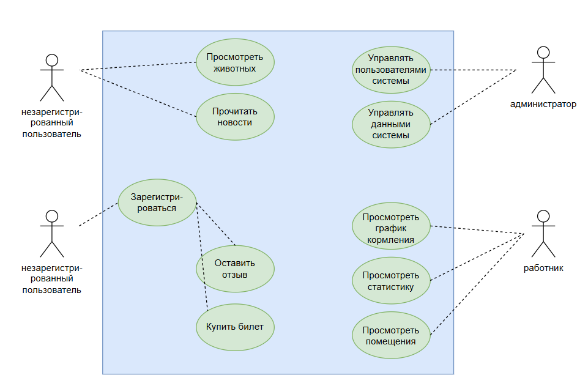

# Спецификация требований

# Назначение системы

Веб-сайт предназначен для предоставления информации о зоопарке посетителям и организации работы сотрудников. Она объединяет сведения о животных, новости, контакты, отзывы, вакансии, билеты, кормление и помещения. Система должна упростить доступ к информации для посетителей и предоставить сотрудникам инструменты для работы с данными зоопарка.

# Бизнес-требования

1. предоставлять посетителям единый сайт с информацией о зоопарке.
2. позволять сотрудникам получать и обрабатывать информацию, связанную с животными, кормлением и помещениями.
3. обеспечивать разграничение доступа в зависимости от роли пользователя.
4. предоставлять статистику, которая помогает оценивать количество животных, потребление корма и показатели, связанные с билетами и посетителями.

# Пользовательские требования и варианты использования

В системе выделяются три основных участника: посетитель сайта, сотрудник зоопарка и администратор.

Посетитель может просматривать информацию о животных и новости, регистрироваться, входить в систему, оставлять отзывы и переходить к разделу билетов.

Сотрудник может входить в систему, просматривать информацию о животных и использовать разделы кормления, помещений и статистики.

Администратор должен иметь возможность управлять данными и пользователями в пределах предоставленных ему прав.

# Функциональные требования

1. отображать главную страницу зоопарка.
2. отображать текущую дату и время на главной странице. Система должна предоставлять раздел со сведениями о животных.
3. предоставлять раздел новостей.
4. отображать последнюю новость на главной странице, если новость доступна.
5. предоставлять пользователю возможность зарегистрироваться.
6. предоставлять пользователю возможность войти в учётную запись и выйти из неё.
7. отображать имя пользователя и его роль после входа в систему.
8. разграничивать доступ к разделам в зависимости от роли пользователя.
9. предоставлять раздел контактов сотрудников.
10. предоставлять раздел отзывов.
11. предоставлять раздел вакансий.
12. предоставлять раздел билетов для пользователей с соответствующими правами.
13. предоставлять сотрудникам и администраторам доступ к разделу кормления.
14. предоставлять сотрудникам и администраторам доступ к разделу помещений.
15. отображать статистику по количеству животных.
16. отображать статистику по кормлению, включая общее количество корма и записи о кормлениях.
17. отображать статистические показатели по билетам, включая количество и цену.
18. предоставлять фильтрацию статистики по названию животного и семейству.
19. предоставлять административную панель для управления данными, доступными администратору.
20. предоставлять посетителю форму покупки билета.

# Нефункциональные требования

1. основные разделы сайта должны быть доступны через понятное меню, а их назначение должно быть понятно пользователю без дополнительной инструкции.
2. закрытые разделы должны быть доступны только авторизованным пользователям с необходимыми правами. Проверка должна выполняться на сервере, а не только путём скрытия ссылок в интерфейсе.
3. пароли и секретные настройки не должны храниться в открытом виде в исходном коде. Секретные параметры должны передаваться через переменные окружения или другой защищённый механизм конфигурации.
4. сайт должен корректно отображаться в актуальных версиях распространённых браузеров, поддерживающих используемый HTML.
5. функциональность должна быть разделена на отдельные Django-приложения с понятной ответственностью.
6. если данные отсутствуют или внешний сервис недоступен, сайт должен показывать понятное сообщение либо предусмотренное значение по умолчанию, а не необработанную техническую ошибку.
